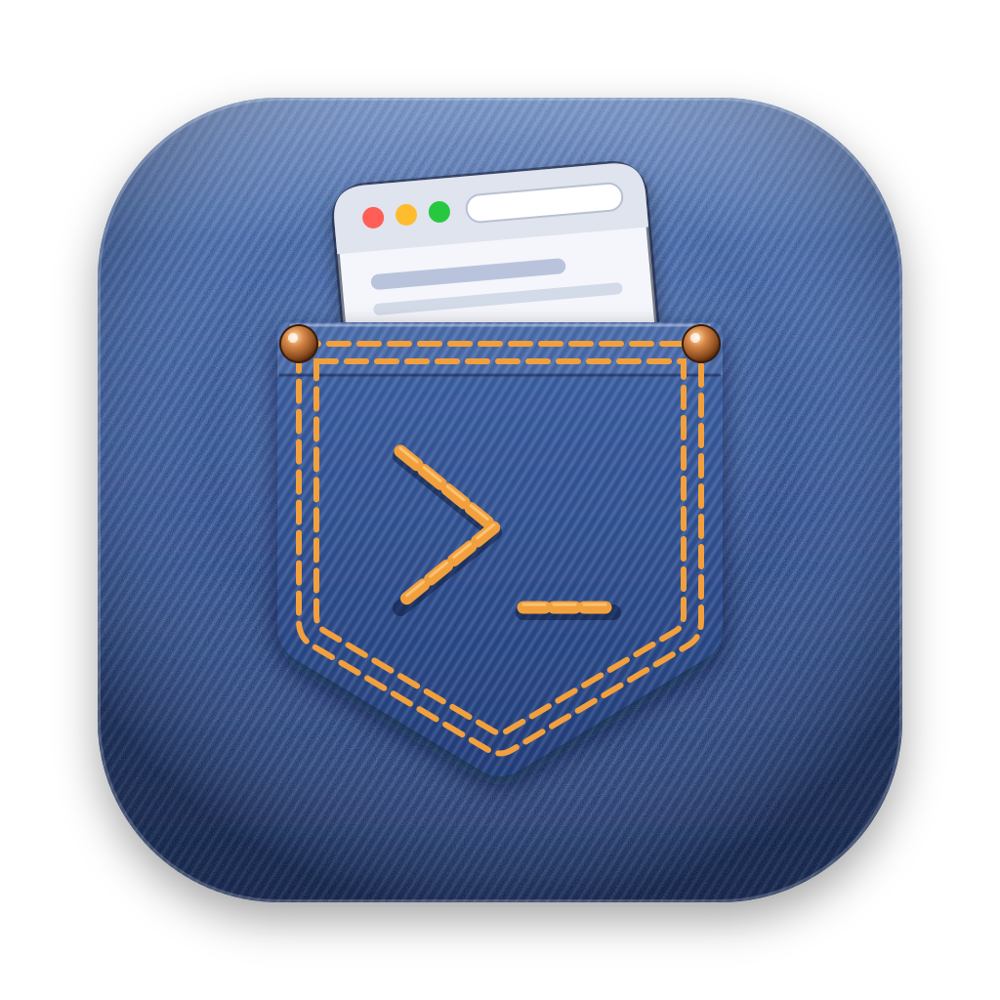
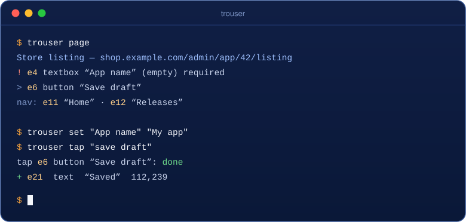

<p align="center">
  
</p>

<h1 align="center">Trouser</h1>

<p align="center">
  <b>A real browser with a real command line.</b><br>
  Scripts and AI agents do the clicking. You keep the keys.
</p>

<p align="center">
  
  
  
  
</p>

<p align="center">
  <a href="#install">Install</a> ·
  <a href="#quick-start">Quick start</a> ·
  <a href="docs/commands.md">Commands</a> ·
  <a href="docs/supervision.md">Supervision</a> ·
  <a href="docs/profiles.md">Profiles</a>
</p>

<p align="center">
  
</p>

Browser automation usually means a headless Chromium, a driver in between, and a script that sleeps and hopes. Trouser is the other way round: a native Mac browser whose every tab answers to one command, `trouser`.

Ask what is on the page and you get a short list of the controls that matter. Tell it what to do and it acts with native mouse and keyboard events, waits for the page to settle, and replies with exactly what changed. It all happens in a window you can watch, inside a profile sealed off from every other site, and anything risky stops and asks you first.

> [!IMPORTANT]
> Trouser is not an everyday browser. It is built for automation: letting scripts and agents get work done on the web. Don't use it for day-to-day browsing, and don't use it for sensitive work such as banking, health, primary email or anything you could not afford to have an automated agent click on.

## What makes it different

<table>
<tr>
<td width="33%" valign="top">
<h4>One step, one reply</h4>
<code>page</code>, <code>tap</code>, read the answer. No sleeps, no polling, no screenshots to squint at.
</td>
<td width="33%" valign="top">
<h4>You stay in charge</h4>
Every command passes your Allow, Ask and Block rules. Publish, delete and pay always ask. Pause stops everything.
</td>
<td width="33%" valign="top">
<h4>Sealed profiles</h4>
Each profile keeps its own cookies, logins, storage, history, settings and rules. Nothing leaks between them.
</td>
</tr>
<tr>
<td valign="top">
<h4>Hands off the page</h4>
Trouser never runs JavaScript in a page. It reads what WebKit rendered and acts with native input events.
</td>
<td valign="top">
<h4>Private by design</h4>
Per-profile content blocking, a local proxy that logs and filters every connection, and one button that burns it all.
</td>
<td valign="top">
<h4>Native and light</h4>
AppKit and WebKit in the App Sandbox. No Chromium, no driver, no runtime to install, no Accessibility permission.
</td>
</tr>
</table>

## Install

Requires macOS 14 or later.

**From a release:** download `Trouser.zip` from the Releases page, then

```sh
unzip Trouser.zip -d /Applications
xattr -dr com.apple.quarantine /Applications/Trouser.app
mkdir -p ~/.local/bin && ln -sf /Applications/Trouser.app/Contents/MacOS/Trouser ~/.local/bin/trouser
```

The release is universal (Apple silicon and Intel) and signed ad hoc, not notarized, so the second line is needed before macOS will open it.

**From source:**

```sh
./scripts/install.sh
```

## Quick start

```sh
trouser open example.com      # open the default profile's window
trouser page                  # what matters on the page, with ids
trouser tap "learn more"      # click the control that matches
trouser page --all            # every element on the page
```

Logins, file pickers, JavaScript dialogs and final irreversible buttons are always yours.

## Documentation

- **[Command line](docs/commands.md)**: every command, the loop, the page model, the site atlas and events
- **[Supervision and rules](docs/supervision.md)**: modes, site rules, protected actions, the navigation fence and certificate pins
- **[Profiles, privacy and modes](docs/profiles.md)**: per-profile settings, the proxy, Burn Everything, background mode and Precise mode
- **[Development](docs/development.md)**: build, test, source layout and the wire protocol

## License

[MIT](LICENSE)
